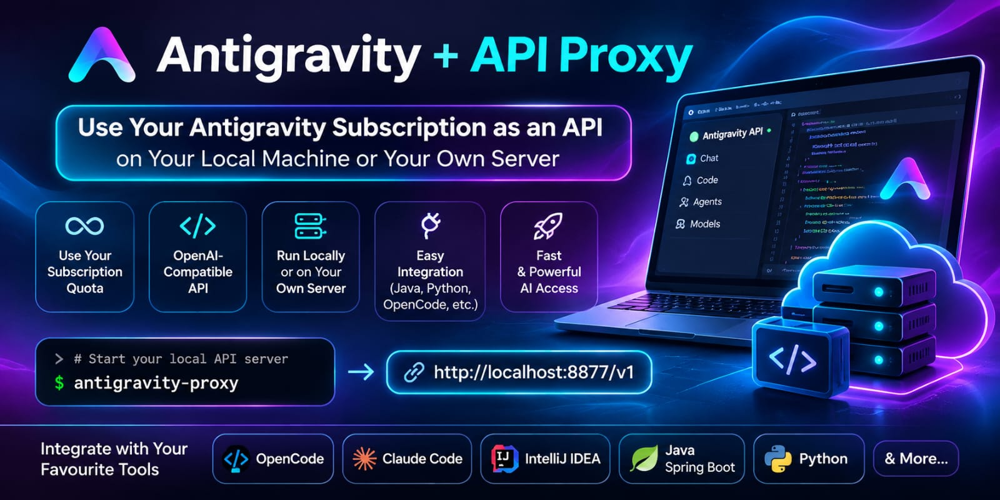
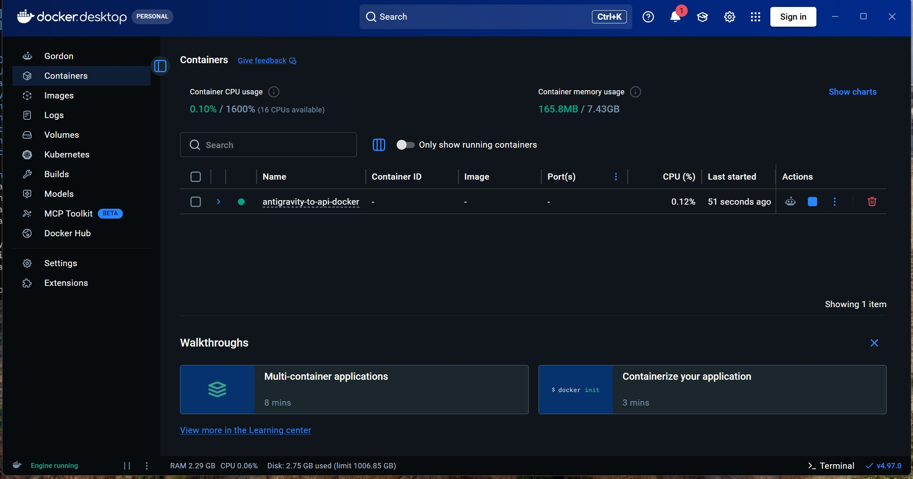
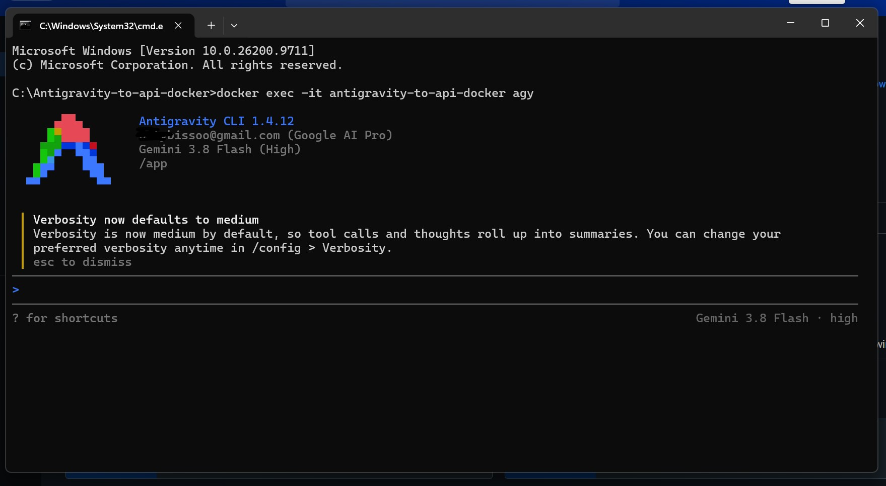
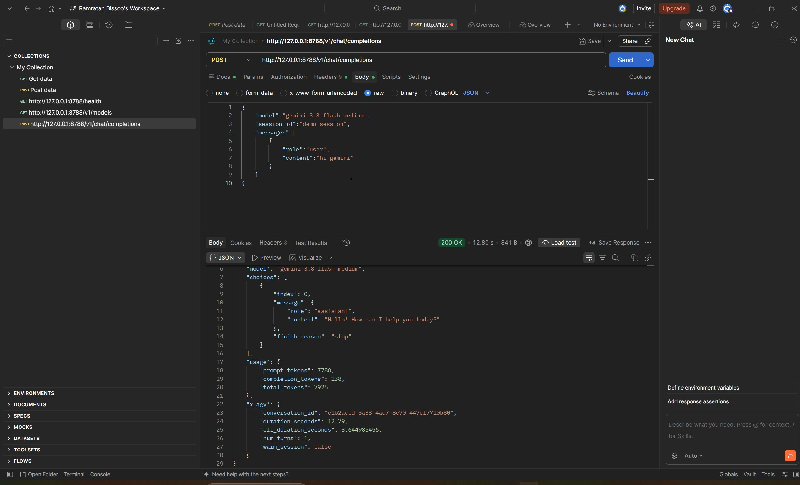

<p align="center">
  
</p>

# Antigravity to API in Docker

Use the AGY (Antigravity) CLI as a local **OpenAI-compatible API**. Every chat is saved to a searchable local archive, and a bundled **MCP server** lets AGY search that archive to recall past conversations.

Runs in Docker or directly with Node.js. No npm dependencies.

## Features

- **OpenAI-compatible endpoints**: `GET /v1/models` and `POST /v1/chat/completions`, with streaming (SSE) support.
- **Warm sessions**: requests that share a `session_id` reuse a running AGY process, so history isn't replayed each turn.
- **Local memory archive**: SQLite FTS5 index plus dated raw JSONL files.
- **Memory HTTP API**: search, grep, read, list dates, stats and import.
- **MCP memory tools**: AGY can search and read the archive itself.
- **Safe defaults**: listens on localhost only, optional Bearer token, limits on concurrent and queued requests.

## Quick start (Docker)

Requires [Docker Desktop](https://www.docker.com/products/docker-desktop/). The image installs the AGY CLI with the official installer.

```bash
# 1. Build and start
docker compose up -d --build
```
<p align="center">
  
</p>

```bash
# 2. Sign in to AGY once (follow the prompts)
docker exec -it antigravity-to-api-docker agy
```
<p align="center">
  
</p>

```bash
# 3. Check it works
curl http://127.0.0.1:8788/v1/models
```

<p align="center">
  
</p>


- The AGY login and the archive are kept in Docker volumes (`agy-login`, `agy-memory`), so they survive restarts and rebuilds.
- The API is published on `127.0.0.1:8788` only.
- To require an API key, set `AGY_API_KEY` in `.env` before starting.
- Stop with `docker compose down`.

## Run without Docker

### Requirements

- Node.js **22.5+** (tested on 24.x). Uses the built-in `node:sqlite` (with FTS5) and `process.loadEnvFile`.
- The AGY CLI installed and signed in. The default path is `~/.local/bin/agy`.

### Setup

1. Open a terminal in the project folder.
2. Create your private config from the template:

   ```bash
   cp .env.example .env            # macOS / Linux
   ```

   ```powershell
   Copy-Item .env.example .env     # Windows PowerShell
   ```

3. Edit `.env` if you need to. The defaults work when AGY is at `~/.local/bin/agy`.
4. Start the server:

   ```bash
   npm start
   ```

5. Check `http://127.0.0.1:8788/health`.

`.env` is ignored by Git, so commit `.env.example`, never `.env`. Variables already set in your shell take precedence over values in `.env`.

## Configuration

| Variable | Default | Purpose |
|---|---|---|
| `HOST` | `127.0.0.1` | Address to listen on. Keep it local unless remote access is secured. |
| `PORT` | `8788` | HTTP port. |
| `AGY_BIN` | `~/.local/bin/agy` | Absolute path to the AGY CLI. |
| `AGY_API_KEY` | *(blank)* | Bearer token. Blank disables auth, so only do that on localhost. |
| `AGY_TIMEOUT_MS` | `300000` | Maximum time for one model turn. |
| `AGY_MAX_CONCURRENT` | `1` | Requests processed at the same time. |
| `AGY_MAX_QUEUE` | `10` | Requests allowed to wait; extra requests get `429`. |
| `AGY_MAX_SESSION_WORKERS` | `1` | Maximum warm AGY sessions kept alive. |
| `AGY_SESSION_IDLE_MS` | `300000` | Idle time before a warm session is closed (minimum 60000). |
| `AGY_MEMORY_DIR` | `./memory` | Where the archive is stored. |

## API reference

Base URL: `http://127.0.0.1:8788`. If `AGY_API_KEY` is set, send `Authorization: Bearer <key>` on every endpoint except `/health`.

| Method | Path | Description |
|---|---|---|
| `GET` | `/health` | Server status, queue and warm-session counts. No auth needed. |
| `GET` | `/v1/models` | Models reported by `agy models` (cached for 5 min, with a built-in fallback list). |
| `POST` | `/v1/chat/completions` | OpenAI-style chat completion. |
| `GET` | `/v1/memory/stats` | Archive location and message/conversation counts. |
| `GET` | `/v1/memory/dates?limit=60` | Dates that have archived messages. |
| `POST` | `/v1/memory/search` | Full-text search: `query`, `queries[]`, `after`, `before`, `role`, `search_type` (`hybrid`\|`exact`), `limit`. |
| `POST` | `/v1/memory/grep` | Literal substring search: `pattern`, `case_sensitive`, `after`, `before`, `limit`. |
| `POST` | `/v1/memory/read` | One message plus nearby messages: `message_id`, `before`, `after`. |
| `POST` | `/v1/memory/ingest` | Import a conversation: `conversation_id`, `messages[]`, `model`, `origin`. |

### Chat completions

Extra request fields on top of the standard OpenAI ones:

- `session_id` (or `conversation_id`): groups turns into one conversation and reuses its warm AGY session. Without it, every request starts a new conversation.
- `stream: true`: streams the answer as Server-Sent Events.

The response also includes `session_id` and an `x_agy` object (CLI duration, turn count, whether a warm session was used).

```bash
curl -s http://127.0.0.1:8788/v1/chat/completions \
  -H 'Content-Type: application/json' \
  -d '{"model":"gemini-3.8-flash-medium","session_id":"demo","messages":[{"role":"user","content":"Hello"}]}'
```

With the OpenAI SDK:

```js
import OpenAI from "openai";

const client = new OpenAI({ baseURL: "http://127.0.0.1:8788/v1", apiKey: "local" });

const result = await client.chat.completions.create({
  model: "gemini-3.8-flash-medium",
  messages: [{ role: "user", content: "Hello from my local project" }],
});

console.log(result.choices[0].message.content);
```

### Error codes

| Status | `code` | Meaning |
|---|---|---|
| `400` | | Invalid JSON, unknown model or missing messages. |
| `401` | | Missing or wrong API key. |
| `413` | | Request body is larger than 2 MB. |
| `429` | `local_queue_full` | The local request queue is full; retry after 10 s. |
| `429` | `upstream_rate_limit` | AGY or the model provider hit a rate limit or quota. |
| `502` | `agy_cli_error` / `empty_model_response` | The CLI failed or the model returned nothing twice. |

## Memory archive

Each chat completion saves the latest user message and the assistant's reply.

```text
memory/
  index.sqlite                  # messages table + FTS5 index
  raw/YYYY/MM/DD/<conversation-id>.jsonl
```

Search, grep, read and indexing run locally and use no model tokens.

```bash
curl -s http://127.0.0.1:8788/v1/memory/search \
  -H 'Content-Type: application/json' \
  -d '{"query":"local server command","queries":["nohup node","port 8788"],"limit":8}'
```

**Importing history:** older conversations (ChatGPT, earlier AGY sessions and so on) are not picked up automatically. Export them and import with `POST /v1/memory/ingest` or the `memory_ingest` tool. Messages whose ID is already stored are skipped.

## MCP memory tools for AGY

[memory-mcp-server.mjs](memory-mcp-server.mjs) is a stdio MCP server with these tools:

| Tool | Purpose |
|---|---|
| `memory_search` | Keyword/FTS search. The tool description tells AGY to build its own search terms rather than reuse the question word for word. |
| `memory_grep` | Exact substring search. |
| `memory_read` | A message plus nearby messages, to check the exact wording. |
| `memory_list_dates` | Dates that have archived messages. |
| `memory_stats` | Archive paths and counts. |
| `memory_ingest` | Import conversation records when the user asks for it. |

Register it once, from the project folder:

```bash
agy mcp add --type stdio agy-memory "$(command -v node)" "$PWD/memory-mcp-server.mjs"
agy mcp list
```

- If AGY can't find Node on its PATH, replace `$(command -v node)` with the absolute path from `which node`.
- The MCP process only uses a custom `AGY_MEMORY_DIR` if that variable is set in the environment AGY runs in.
- Restart any running AGY session afterwards so it loads the new tools.
- Headless AGY needs a permission grant for each tool in `~/.gemini/antigravity-cli/settings.json`: `mcp(memory_search)`, `mcp(memory_grep)`, `mcp(memory_read)`, `mcp(memory_list_dates)`, `mcp(memory_stats)`, `mcp(memory_ingest)`. Don't use `--dangerously-skip-permissions`.

## Project layout

| File | Role |
|---|---|
| [api-server.mjs](api-server.mjs) | HTTP server, request queue, warm AGY session pool. |
| [memory-db.mjs](memory-db.mjs) | SQLite/FTS5 index and JSONL archive. |
| [memory-mcp-server.mjs](memory-mcp-server.mjs) | MCP server that exposes the memory tools. |
| [env-loader.mjs](env-loader.mjs) | Loads `.env` without any dependencies. |
| [Dockerfile](Dockerfile), [docker-compose.yml](docker-compose.yml) | Container build and run. |
| [Antigravity-to-API-Docker.postman_collection.json](Antigravity-to-API-Docker.postman_collection.json) | Ready-made Postman requests. |

## Limitations

- Search is full-text (FTS5) with a substring fallback. There is no semantic or vector search yet.
- Recall from memory only works when AGY calls the MCP tools. The HTTP bridge doesn't support OpenAI `tools`/function-calling payloads.
- Image inputs are replaced with a placeholder; only text is sent to AGY.
- AGY's reasoning and answers still use model tokens and count against your quota.
